# R2-A.1 / A1 — Marke, Header, Hero, Footer

Status: **A1 visuell vom Owner freigegeben.** Diese Freigabe umfasst Header, Hero und die lokal als Draft markierte ViralSync-Beispielkarte. Sie ist keine Freigabe, den ViralSync-Inhalt öffentlich zu schalten.

- `old-*`: bisherige Live-Site (`uguroezdamar.com`, Stand `c8ff3a3`), aufgenommen am 12.10.2026.
- `new-*`: lokaler Produktionsbuild (`next build` + `next start`) des A1-Stands. Die Vorschau lief ohne erreichbare Datenbank; die CMS-Sektionen unterhalb des Heros sind nicht Gegenstand dieses Checkpoints.
- Die abgelehnte R2-A-Fassung liegt zum Vergleich unter [`../r2-a/`](../r2-a/README.md).

## Erster Viewport

| Viewport | Alt, hell | Neu, hell | Alt, dunkel | Neu, dunkel |
| --- | --- | --- | --- | --- |
| 375 px | 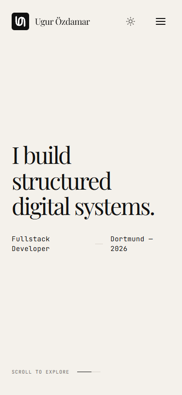 | 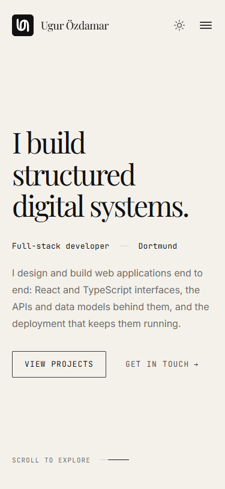 | 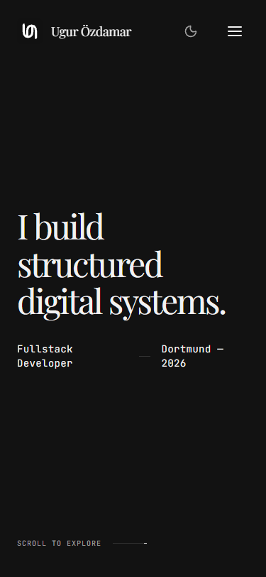 | 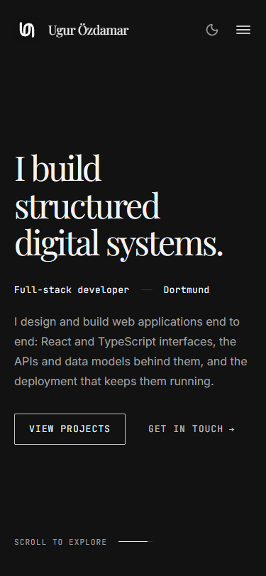 |
| 768 px | 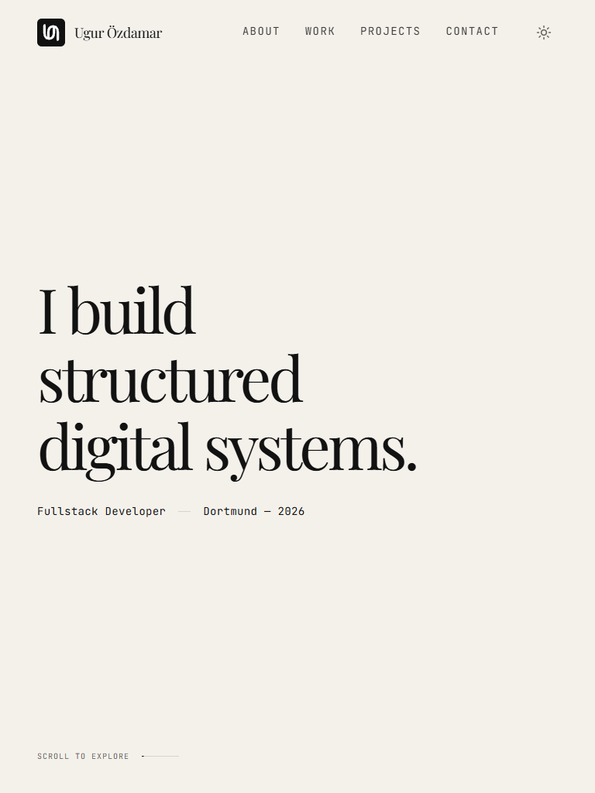 | 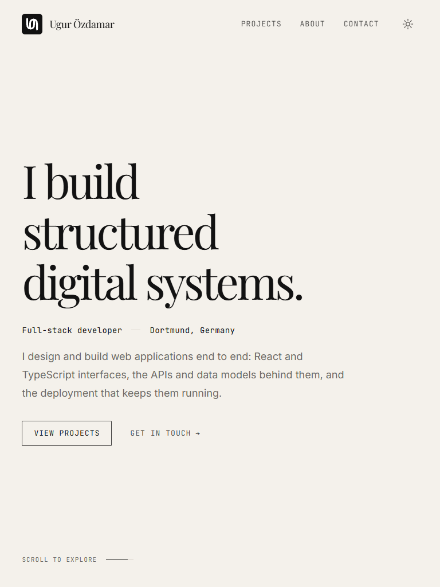 | 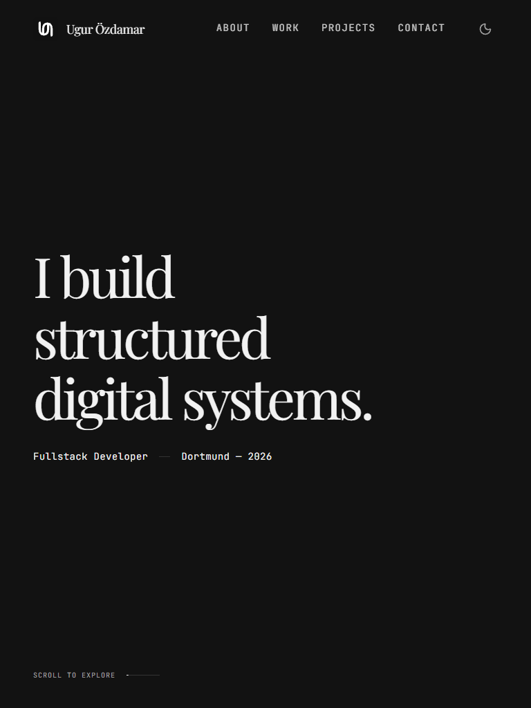 | 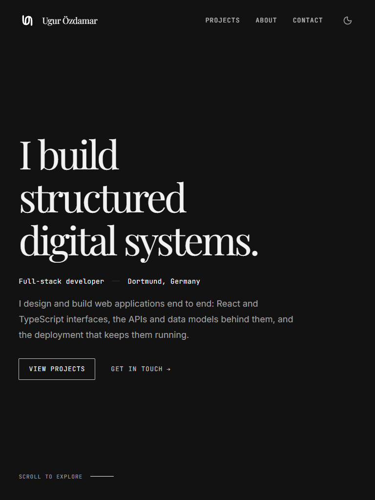 |
| 1440 px | 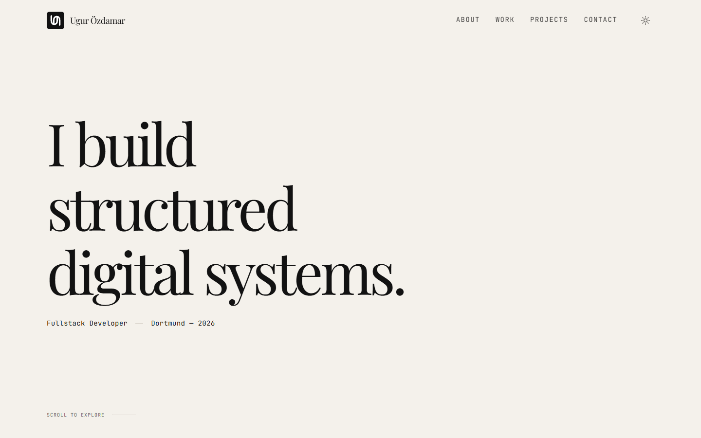 | 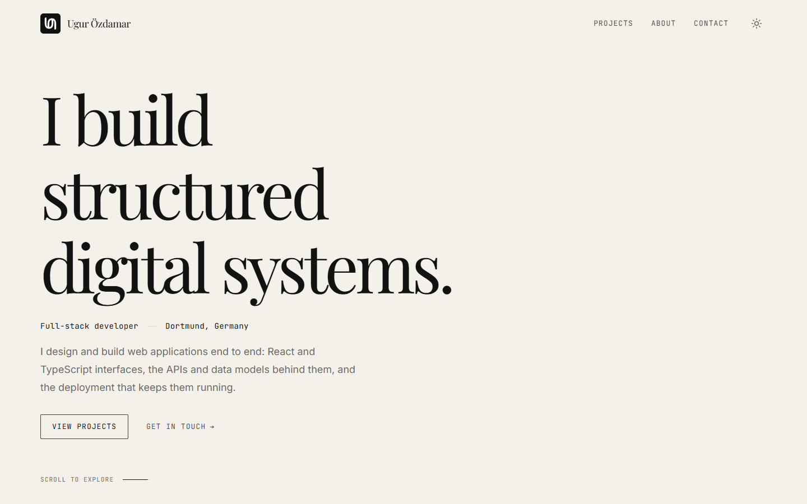 | 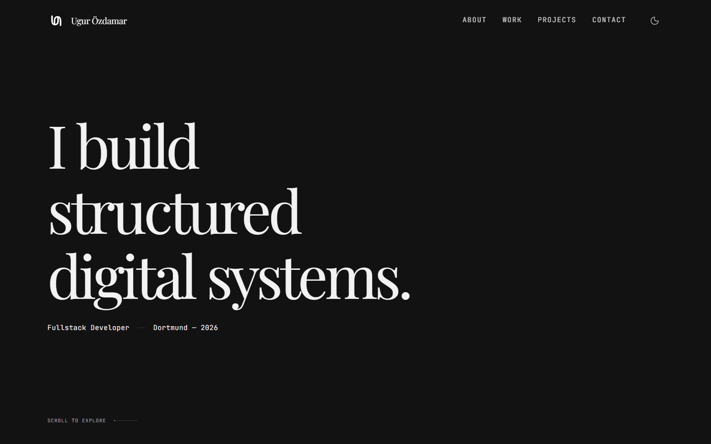 | 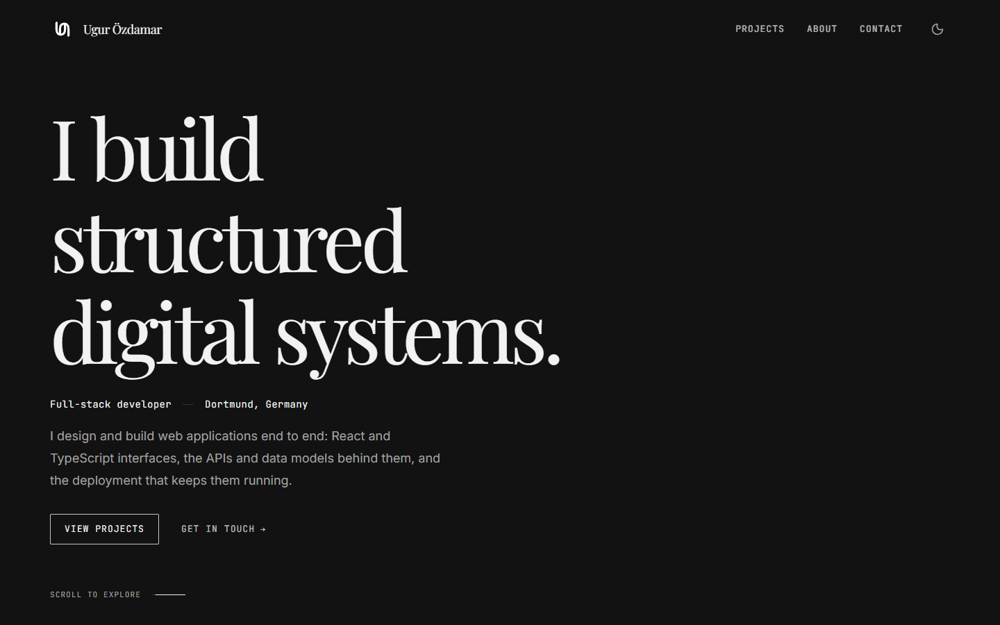 |

## Mobiles Menü und Footer

| Mobiles Menü, 375 px dunkel | Footer, 1440 px hell |
| --- | --- |
| 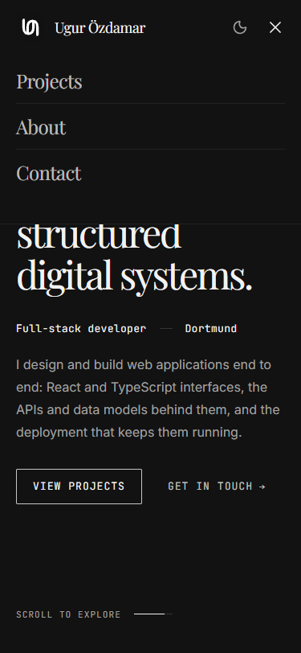 | 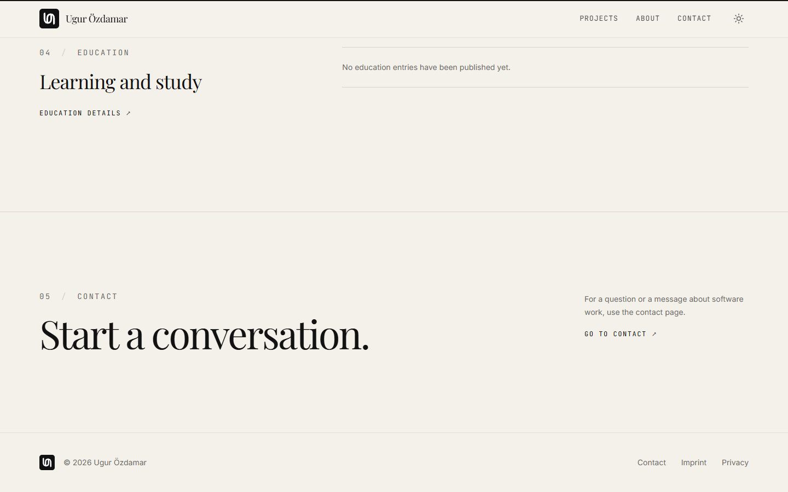 |

## Übernommen aus der alten Fassung

- Originales Logo aus `apps/site/app/icon.svg` in Header, Footer und Favicon; `tests/brand-mark.test.tsx` hält Inline-Komponente und Datei deckungsgleich.
- Dreizeilige Serifen-Headline „I build / structured / digital systems.“ in alter Größe (3 rem / 5 rem / 7,5 rem), linker Schwerpunkt, freie rechte Fläche.
- Mono-Zeile unter der Headline, „Scroll to explore“-Linie, transparenter Header über dem Hero, einzeiliger Footer.

## Gezielt verbessert

- Kurze Beschreibung und zwei zurückhaltende Aktionen (Projekte, Kontakt).
- Headline skaliert unter 375 px und auf niedrigen Desktop-Viewports mit, statt umzubrechen oder aus dem Viewport zu laufen.
- Funktionierendes mobiles Menü (vorher ein Button ohne Funktion) mit denselben Einträgen wie die Desktop-Navigation, Escape und sichtbarem Fokus; Skip-Link bleibt.
- Navigation reduziert auf Projects, About, Contact; Footer mit Contact, Imprint, Privacy.
- Linkfarben: Eine ungelayerte Regel `a { color: inherit }` setzte Farb-Utilities auf Links außer Kraft und wurde entfernt.

## Prüfprotokoll

- `pnpm lint`, `pnpm typecheck`, `pnpm test` (59 bestanden, 5 DB-Integrationstests ohne `TEST_MONGODB_URI` übersprungen), `pnpm build:site`.
- 320, 375, 768, 1024, 1440, 1920 px: `scrollWidth` gleich Viewport-Breite.
- `/`, `/projects`, `/about`, `/contact`, `/imprint`, `/privacy`, `/icon.svg` liefern 200; keine Seitenfehler in der Browser-Konsole des Produktionsbuilds.
- Mobiles Menü schließt mit Escape (`aria-expanded="false"`).
- Noch offen: Axe-Lauf, vollständige manuelle Tastaturprüfung, Prüfung mit befüllter Preview-Datenbank (A2).
